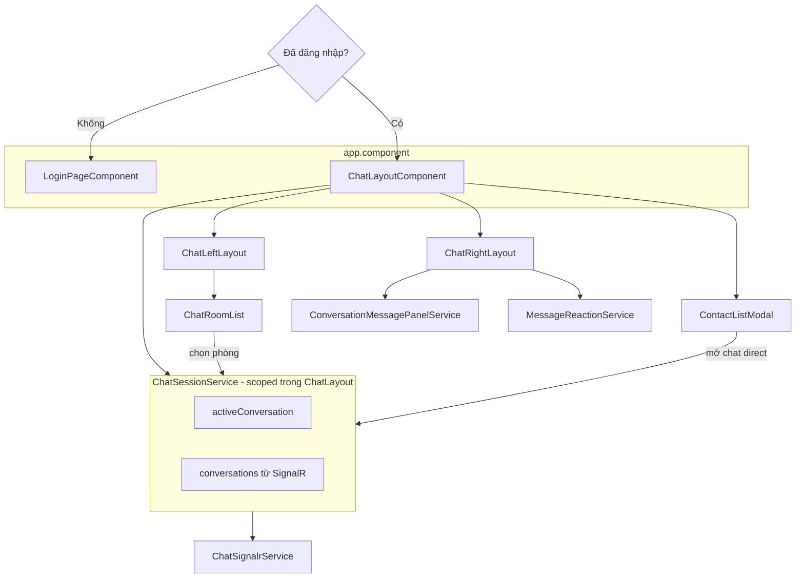

# Kiến trúc AMT Chat Internal

Tài liệu mô tả **cấu trúc hiện tại** của dự án sau khi tách layer theo quy ước:

| Layer | Trách nhiệm |
|-------|-------------|
| **models/** | Kiểu dữ liệu, interface, DTO — không chứa logic |
| **services/** | Gọi API/SignalR, tính toán, trạng thái nghiệp vụ, map dữ liệu server → domain |
| **components/** | Hiển thị UI, tương tác người dùng, hiệu ứng DOM (focus, scroll, menu) |
| **shared/** | Thành phần dùng chung nhiều feature (pipe, UI kit, util hiển thị) |
| **core/** | Hạ tầng toàn app (auth interceptor, theme, layout shell, asset URL) |

---

## 1. Cây thư mục tổng quan

```
src/
├── app/
│   ├── app.component.ts          # Root: login hoặc chat shell
│   ├── app.config.ts             # HTTP, router, interceptor
│   ├── app.routes.ts             # (hiện chưa khai báo route con)
│   │
│   ├── core/                     # Hạ tầng & layout chính
│   │   ├── interceptors/
│   │   ├── layouts/chat-layout/  # Shell 2 cột: trái danh sách, phải hội thoại
│   │   ├── models/               # Api<T> wrapper chung
│   │   └── services/             # Token, theme, tray, notification, asset URL
│   │
│   ├── shared/                   # Dùng chung
│   │   ├── pipes/                # emoji-html
│   │   ├── ui/                   # modal, message-box, loading-button
│   │   └── utils/                # display.util (initials, preview, subtitle)
│   │
│   └── features/                 # Nghiệp vụ theo domain
│       ├── auth/
│       ├── chat/
│       └── contact/
│
├── assets/
├── environments/
└── styles/
```

---

## 2. Luồng ứng dụng chính



**Hành vi quan trọng (giữ sau refactor):**

- Khi vào app, **không** tự mở phòng chat đầu tiên — user phải chọn phòng trong danh sách.
- `ChatSessionService` đồng bộ phòng đang mở với danh sách từ server, join room SignalR, đánh dấu đã đọc khi focus ô nhập tin.

---

## 3. Core (`src/app/core/`)

Phần **không phụ thuộc** một feature cụ thể; cung cấp nền cho toàn app.

### 3.1 `core/models/`

| File | Mục đích |
|------|----------|
| `api.model.ts` | Wrapper `Api<T>` cho response HTTP chuẩn của backend (`success`, `data`, `message`). |

### 3.2 `core/services/`

| Service | Làm gì |
|---------|--------|
| `token.service.ts` | Lưu/đọc access token, user từ JWT, kiểm tra hết hạn. |
| `auth.interceptor` (interceptors) | Gắn `Authorization` vào request HTTP. |
| `theme.service.ts` | Dark/light mode. |
| `tray.service.ts` | Tích hợp system tray (Tauri). |
| `notification.service.ts` | Thông báo desktop khi có tin mới (khi cửa sổ không focus). |
| `asset-url.service.ts` | Chuẩn hóa URL tương đối → URL đầy đủ (dùng bởi SignalR & sticker). |

### 3.3 `core/layouts/chat-layout/`

Layout **shell** chat: ghép trái + phải, không chứa domain model (import từ `features/chat/models`).

| Component | Vai trò |
|-----------|---------|
| `chat-layout.component` | Orchestrator: inject `ChatSessionService`, truyền data xuống con, xử lý logout, mở modal contact, mobile back. |
| `chat-left-layout.component` | Header user, search, menu drawer, nhúng `ChatRoomList`. |
| `chat-right-layout.component` | Panel tin nhắn + composer; **UI** focus/scroll/context menu; gọi service cho dữ liệu hiển thị. |
| `chat-menu-drawer.component` | Menu cài đặt: theme, logout, mở danh bạ. |

---

## 4. Shared (`src/app/shared/`)

| Thư mục | Nội dung |
|---------|----------|
| `pipes/emoji-html/` | Render emoji shortcode trong HTML an toàn. |
| `ui/modal/` | Modal dùng chung (contact list). |
| `ui/message-box/` | Hộp thoại xác nhận (logout, xóa tin). |
| `ui/loading-button/` | Nút có trạng thái loading. |
| `utils/display.util.ts` | **Chỉ format hiển thị**: initials, preview tin (`[Sticker]`), subtitle online/group, helper sticker/reply. Không gọi API. |

---

## 5. Feature: Auth (`features/auth/`)

| Node | Vai trò |
|------|---------|
| **models/** `auth-user.model.ts`, `auth.model.ts` | Kiểu user, payload login. |
| **services/** `auth.service.ts` | Login, refresh token, logout, signal trạng thái đăng nhập. |
| **pages/login-page/** | Form đăng nhập, gọi `AuthService`. |

---

## 6. Feature: Chat (`features/chat/`)

Trung tâm nghiệp vụ chat realtime.

### 6.1 Models (`features/chat/models/`)

Chỉ **định nghĩa shape dữ liệu** — không logic.

| File | Nội dung |
|------|----------|
| `conversation.model.ts` | `ConversationPreview`, `ConversationMessage`, `ConversationDisplayMessage`, `ConversationMessageSendRequest` — domain UI của một phòng chat. |
| `direct-room.model.ts` | `DirectRoomOpenRequest`, `DirectRoomReadyPayload` (payload SignalR). |
| `chat-message.dto.ts` | DTO tin nhắn từ hub (hỗ trợ cả PascalCase từ .NET). |
| `room-summary.model.ts` | DTO phòng trong `UpdateRoomList`. |
| `hub-connection.model.ts` | `HubConnectionStatus`. |
| `message-context-menu.model.ts` | Action/position menu chuột phải, reaction picker position. |
| `message-reaction.model.ts` | `MessageReaction` (shortcode, count, reactedByMe). |
| `sticker.model.ts` | Domain sticker pack đã map. |
| `sticker-response.model.ts` | DTO API sticker trước khi map. |

### 6.2 Services (`features/chat/services/`)

| Service | Làm gì | Phụ thuộc chính |
|---------|--------|-----------------|
| `chat-signalr.service.ts` | Kết nối hub, `UpdateRoomList`, `LoadMessages`, `ReceiveMessage`, join/leave/send/read, map DTO → `ConversationPreview` / `ConversationMessage`, draft room, notification tin mới. | `ConversationFormatService`, `AssetUrlService` |
| `chat-session.service.ts` | **Phiên chat UI**: `activeConversation`, sync với list phòng, `selectConversation`, `openDirectRoom`, `sendMessage`, đọc tin khi composer focus, logout disconnect. | `ChatSignalrService`, `ConversationFormatService` |
| `conversation-format.service.ts` | Format thời gian (`Hôm qua`, giờ), preview tin, tên phòng, chuẩn hóa loại Text/Sticker. | — |
| `conversation-message-panel.service.ts` | **Scoped** trong `ChatRightLayout`: enrich reply, mark/select/delete local, `buildDisplayMessages()`. | models only |
| `direct-chat.service.ts` | Facade mỏng: `getOrCreateDirectRoom` → SignalR. | `ChatSignalrService` |
| `message-reaction.service.ts` | State reaction theo `messageId` (client-side, chưa persist server). | — |
| `sticker.service.ts` | HTTP sticker packs, tải/cài pack (Tauri invoke), map DTO → domain. | `AssetUrlService` |
| `emoji-recent.service.ts` | Lưu emoji dùng gần đây (localStorage). | — |

### 6.3 Components (`features/chat/components/`)

| Component | Xử lý gì (UI) |
|-----------|----------------|
| `chat-room-list` | Danh sách phòng; highlight active; **lọc search** theo tên/tin (presentation); emit khi user click. |
| `message-context-menu` | Menu chuột phải: reply, mark, select, copy, delete. |
| `message-reaction-picker` | Popover chọn reaction. |
| `emoji-picker` | Tab emoji / sticker; emit token hoặc sticker. |
| `emoji-list` | Lưới emoji. |
| `sticker-panel` | Thư viện sticker, tải pack — **vẫn gọi HTTP trong component** (có thể tách facade sau). |

---

## 7. Feature: Contact (`features/contact/`)

| Node | Vai trò |
|------|---------|
| **models/** `contact.model.ts` | `ContactItem` — domain danh bạ. |
| **models/** `contact-response.model.ts` | DTO API `/contact`. |
| **models/** `direct-room-ready.model.ts` | `DirectRoomReadyEvent` — event sau khi tạo/mở phòng 1-1. |
| **services/** `contact.service.ts` | `GET /contact` → map `ContactResponseItem[]` → `ContactItem[]`. |
| **services/** `contact-list-state.service.ts` | Cache danh sách contact, loading/error, `filterContacts()` cho search. |
| **services/** `contact-chat.service.ts` | `openDirectRoom(contact)` → `DirectChatService` → trả `DirectRoomReadyEvent`. |
| **components/** `contact-list-modal` | Modal UI: search, list, loading; gọi `ContactListStateService` + `ContactChatService`; emit `directRoomReady`. |

---

## 8. Phân tầng chi tiết — ví dụ một tin nhắn

```
Server (SignalR)
    │  ChatMessageDto
    ▼
chat-signalr.service     mapMessage(), format time/preview
    │  ConversationMessage
    ▼
ConversationPreview.messages
    │  activeConversation (chat-session)
    ▼
conversation-message-panel.service   enrich reply, mark/select, filter deleted
    │  ConversationDisplayMessage[]
    ▼
chat-right-layout.component   template, scroll, focus composer, context menu
    │  display.util             initials, subtitle, [Sticker] label
    ▼
HTML + emoji-html pipe
```

---

## 9. Quy tắc import (tránh vi phạm layer)

| Được | Không nên |
|------|-----------|
| `features/chat` → `features/chat/models` | Feature import model từ `core/layouts` |
| `core/layouts` → `features/chat/models` | Component gọi HTTP/SignalR trực tiếp thay vì service |
| `components` → `services`, `shared/utils` | Service import component |
| `services` → `models`, `core/services` | Model chứa `inject()` hay gọi API |

---

## 10. Provider & vòng đời service

| Service | Scope | Ghi chú |
|---------|-------|---------|
| `ChatSessionService` | `providers` trên `ChatLayoutComponent` | Một phiên chat mỗi lần vào layout |
| `ConversationMessagePanelService` | `providers` trên `ChatRightLayoutComponent` | Reset khi đổi phòng / destroy panel |
| Còn lại (`ChatSignalrService`, `AuthService`, …) | `providedIn: 'root'` | Singleton toàn app |

---

## 11. Các điểm còn có thể cải thiện (không chặn hiện tại)

- `sticker-panel.component.ts`: logic tải sticker vẫn nằm trong component → có thể tách `StickerPanelFacadeService`.
- `emoji-recent.service.ts`: interface `RecentEmojiUsage` có thể chuyển sang `models/`.
- `login-page`: initials có thể dùng `formatInitials()` từ `display.util.ts` cho thống nhất.

---

## 12. Tham chiếu nhanh — file quan trọng

| Cần sửa… | Mở file |
|-----------|---------|
| Không auto mở phòng đầu | `features/chat/services/chat-session.service.ts` |
| Logic SignalR / danh sách phòng | `features/chat/services/chat-signalr.service.ts` |
| Format giờ / preview sidebar | `features/chat/services/conversation-format.service.ts` |
| Enrich tin / xóa local | `features/chat/services/conversation-message-panel.service.ts` |
| Focus composer / scroll | `core/layouts/chat-layout/chat-right-layout/chat-right-layout.component.ts` |
| Kiểu dữ liệu hội thoại | `features/chat/models/conversation.model.ts` |
| Mở chat từ danh bạ | `features/contact/services/contact-chat.service.ts` |

---

*Tài liệu đồng bộ với cấu trúc sau refactor layer (models / services / components). Cập nhật file này khi thêm feature hoặc đổi trách nhiệm service.*
