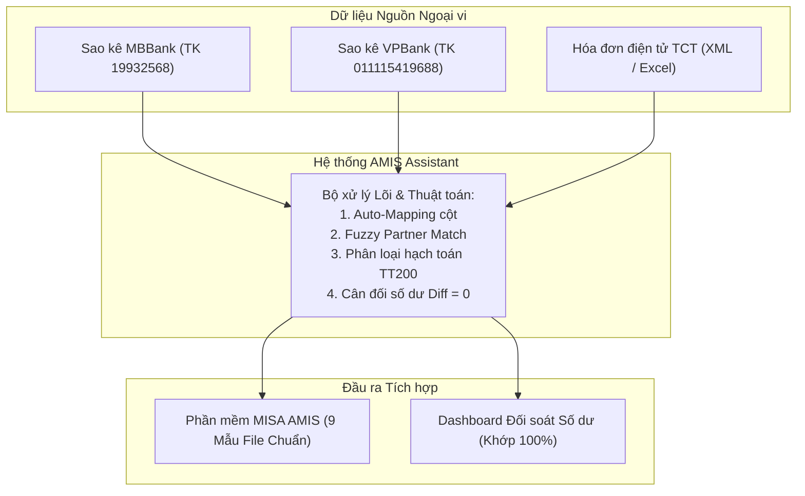
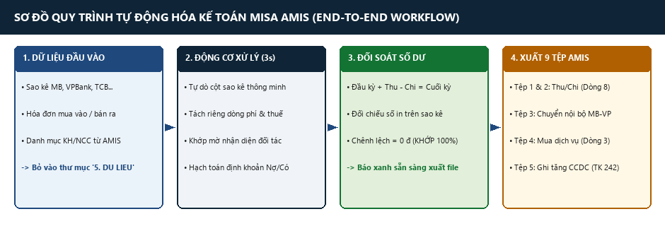
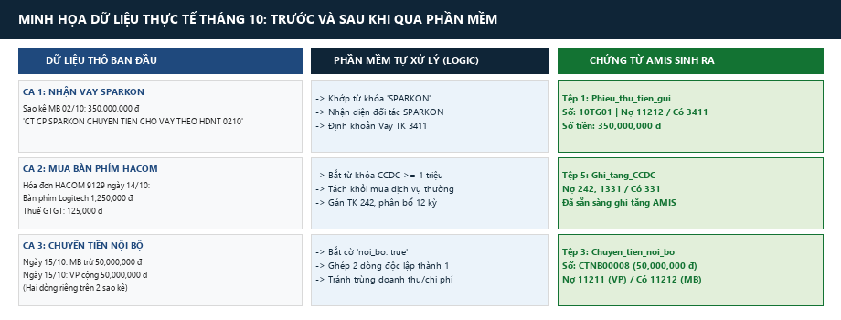
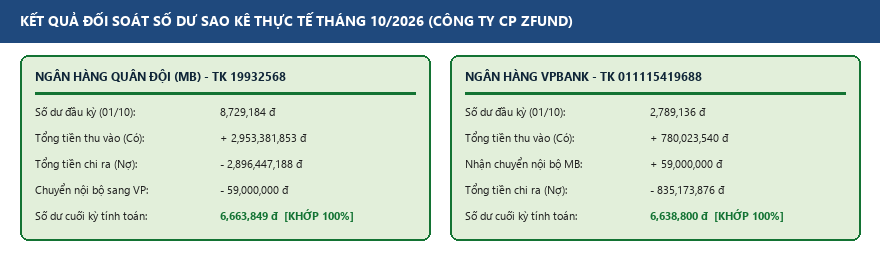
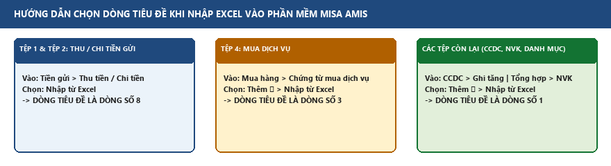

# TÀI LIỆU ĐẶC TẢ YÊU CẦU HỆ THỐNG (SYSTEM DEVELOPMENT REQUIREMENT - SDR)
> **Dự án:** AMIS MISA Accounting Automation & Reconciliation Assistant  
> **Khách hàng / Doanh nghiệp áp dụng:** Công ty Cổ phần ZFUND
> **Người phụ trách nghiệp vụ:** Kế toán trưởng  
> **Phiên bản:** `v2.5.0` (Cập nhật Kiến trúc Nghiệp vụ Toàn diện: Soạn thảo văn bản, Dự kiến thu chi, ClosedXML & Cổng khách hàng AI)  

[-brightgreen.svg)](#)

---

## 📑 MỤC LỤC TỔNG QUAN
- [I. TỔNG QUAN & PHẠM VI HỆ THỐNG](#i-tổng-quan--phạm-vi-hệ-thống)
  - [1.1. Bối cảnh & Bài toán nghiệp vụ](#11-bối-cảnh--bài-toán-nghiệp-vụ)
  - [1.2. Các bên tham gia (Actors & Roles)](#12-các-bên-tham-gia-actors--roles)
  - [1.3. Giao tiếp & Tích hợp ngoại vi](#13-giao-tiếp--tích-hợp-ngoại-vi)
- [II. QUY TRÌNH NGHIỆP VỤ TỔNG THỂ (WORKFLOW)](#ii-quy-trình-nghiệp-vụ-tổng-thể-workflow)
  - [2.1. Sơ đồ luồng End-to-End](#21-sơ-đồ-luồng-end-to-end)
  - [2.2. Bảng phân bước hành động Người dùng vs Hệ thống](#22-bảng-phân-bước-hành-động-người-dùng-vs-hệ-thống)
- [III. CƠ CHẾ LOGIC & THUẬT TOÁN XỬ LÝ LÕI](#iii-cơ-chế-logic--thuật-toán-xử-lý-lõi)
  - [3.1. Nhận diện cột tự động (Auto-Mapping Heuristic)](#31-nhận-diện-cột-tự-động-auto-mapping-heuristic)
  - [3.2. Thuật toán Fuzzy Matching đối tác 8 cấp độ](#32-thuật-toán-fuzzy-matching-đối-tác-8-cấp-độ)
  - [3.3. Công thức kiểm soát cân bằng số dư ngân hàng](#33-công-thức-kiểm-soát-cân-bằng-số-dư-ngân-hàng)
  - [3.4. Quy tắc sinh số chứng từ](#34-quy-tắc-sinh-số-chứng-từ)
- [IV. CÁC PHÂN HỆ MỞ RỘNG MỚI & LOGIC NGHIỆP VỤ NÂNG CAO](#iv-các-phân-hệ-mở-rộng-mới--logic-nghiệp-vụ-nâng-cao)
  - [4.1. Phân hệ Soạn thảo văn bản & Hợp đồng tự động theo mẫu](#41-phân-hệ-soạn-thảo-văn-bản--hợp-đồng-tự-động-theo-mẫu-document--contract-generation-engine)
  - [4.2. Phân hệ Kế hoạch Dự kiến thu chi & Trình sếp duyệt (Auto-Contract)](#42-phân-hệ-kế-hoạch-dự-kiến-thu-chi--trình-sếp-duyệt-cash-flow-planning--auto-contract-workflow)
  - [4.3. Bảng kê Mua vào / Bán ra đọc file thực tế từ ổ đĩa (ClosedXML)](#43-bảng-kê-mua-vào--bán-ra-đọc-file-thực-tế-từ-ổ-đĩa-direct-excel-parsing-via-closedxml)
  - [4.4. Cổng giao tiếp Khách hàng & Trợ lý Thông minh AI](#44-cổng-giao-tiếp-khách-hàng--trợ-lý-thông-minh-ai-customer-portal--ai-assistant)
  - [4.5. Cơ chế Tải tệp Độc lập (HttpClient Blob Streaming)](#45-cơ-chế-tải-tệp-độc-lập-httpclient-blob-streaming)
<!-- [TẠM ẨN THEO YÊU CẦU]
- [IV. CÁC TÌNH HUỐNG ĐẶC BIỆT & CASE STUDY THỰC TẾ (ZFUND THÁNG 10/2026)](#iv-các-tình-huống-đặc-biệt--case-study-thực-tế-zfund-tháng-102026)
  - [4.1. Case 1: Khoản vay công ty liên kết (Sparkon 350M)](#41-case-1-khoản-vay-công-ty-liên-kết-sparkon-350m)
  - [4.2. Case 2: Tách mua công cụ dụng cụ (Bàn phím cơ HACOM)](#42-case-2-tách-mua-công-cụ-dụng-cụ-bàn-phím-cơ-hacom)
  - [4.3. Case 3: Giao dịch thẻ quốc tế & Tách phí giao dịch VPBank](#43-case-3-giao-dịch-thẻ-quốc-tế--tách-phí-giao-dịch-vpbank)
  - [4.4. Case 4: Lệnh chuyển tiền nội bộ giữa các tài khoản ngân hàng](#44-case-4-lệnh-chuyển-tiền-nội-bộ-giữa-các-tài-khoản-ngân-hàng)
-->
- [V. BÁO CÁO ĐỐI SOÁT SỐ DƯ THỰC TẾ](#v-báo-cáo-đối-soát-số-dư-thực-tế)
- [VI. HƯỚNG DẪN 9 FILE EXCEL XUẤT CHO MISA AMIS](#vi-hướng-dẫn-9-file-excel-xuất-cho-misa-amis)

---

## I. TỔNG QUAN & PHẠM VI HỆ THỐNG

### 1.1. Bối cảnh & Bài toán nghiệp vụ
* **Đơn vị vận hành:** Công ty Cổ phần ZFUND (Mã số thuế: `0111154196`).
* **Vấn đề tồn tại:** 
  - Hàng tháng, kế toán phải xử lý hàng trăm giao dịch sao kê từ nhiều ngân hàng (MBBank, VPBank, Techcombank...) và hàng trăm hóa đơn điện tử đầu vào/đầu ra từ cổng Tổng cục Thuế.
  - Các ngân hàng xuất file sao kê với định dạng cột, dòng tiêu đề và nội dung biến động khác nhau hoàn toàn.
  - Việc đọc nội dung chuyển khoản để tìm mã đối tác, tra cứu mã số thuế, gõ tay từng dòng vào MISA AMIS gây tốn từ 6 - 8 tiếng/ngày, dễ nhầm tài khoản hạch toán, sai số dư và trùng lặp lệnh chuyển tiền nội bộ.
* **Mục tiêu hệ thống:** 
  - Tự động hóa 100% quy trình đọc sao kê và hóa đơn XML/Excel.
  - Phân tích nội dung giao dịch bằng thuật toán Fuzzy Matching và bộ quy tắc nghiệp vụ (Accounting Rule Engine).
  - Tự động cân đối số dư ngân hàng (đảm bảo độ lệch $Diff = 0$).
  - Xuất ra đúng 9 file mẫu chuẩn định dạng của phần mềm MISA AMIS để kế toán chỉ cần chọn chức năng **Nhập từ Excel** là hoàn tất.

### 1.2. Các bên tham gia (Actors & Roles)
| Vai trò | Người phụ trách đại diện | Quyền hạn & Trách nhiệm chính |
| :--- | :--- | :--- |
| **Kế toán trưởng (Chief Accountant)** | Kế toán trưởng phụ trách | • Phê duyệt bảng đối soát số dư ngân hàng hàng tháng. • Cấu hình các quy tắc hạch toán mới, tài khoản ngầm định (TK 242, 3411, 642, 11211, 11212). • Kiểm tra và nhấn nút xuất 9 file import AMIS. |
| **Kế toán viên (Accountant)** | Kế toán viên phụ trách | • Tải sao kê từ Internet Banking và hóa đơn TCT. • Kéo thả file vào phần mềm để hệ thống tự động phân loại. • Xử lý các dòng cảnh báo chưa khớp đối tác (nếu có). |
| **Quản trị hệ thống (Admin)** | Đội ngũ kỹ thuật | • Quản lý cơ sở dữ liệu , đồng bộ danh mục đối tác và phân quyền người dùng. |

### 1.3. Giao tiếp & Tích hợp ngoại vi

---

## II. QUY TRÌNH NGHIỆP VỤ TỔNG THỂ (WORKFLOW)

### 2.1. Sơ đồ luồng End-to-End

### 2.2. Bảng phân bước hành động Người dùng vs Hệ thống
| Bước | Tên bước & Phụ trách | Hành động của Kế toán | Xử lý kỹ thuật của Hệ thống |
| :---: | :--- | :--- | :--- |
| **1** | **Thu thập dữ liệu** *(Kế toán viên)* | Tải file sao kê Excel tháng từ MBBank, VPBank và file bảng kê hóa đơn XML từ trang thuế. | Hệ thống sẵn sàng ở trạng thái chờ tiếp nhận tệp. |
| **2** | **Kéo thả & Nạp file** *(Kế toán viên)* | Kéo thả cùng lúc file sao kê và hóa đơn vào màn hình Import. | Tự động quét Header, nhận diện ngân hàng bằng bộ từ khóa Heuristic (`Score >= 4`). |
| **3** | **Tự động Phân tích & Hạch toán** *(Hệ thống)* | Không cần thao tác, quan sát thanh tiến trình xử lý. | • Chạy thuật toán Fuzzy Matching 8 cấp tìm mã Đối tác trong `HUNG_DB2`. • Nhận diện tài khoản hạch toán theo Rule Engine. • Bóc tách phí thẻ ngân hàng và thuế GTGT. |
| **4** | **Kiểm soát & Đối soát số dư** *(Kế toán trưởng)* | Xem bảng Dashboard đối soát số dư tồn đầu kỳ, tổng thu, tổng chi và tồn cuối kỳ. | Tính toán công thức cân bằng tài chính: $\Delta = Tồn_{cuối} - (Tồn_{đầu} + Thu - Chi)$. Nếu $\Delta = 0$ hiển thị huy hiệu xanh lá. |
| **5** | **Xuất file & Nạp vào MISA** *(Kế toán trưởng)* | Nhấn nút **"Xuất 9 File AMIS"** và tiến hành import vào phần mềm MISA AMIS. | Sinh 9 file Excel đúng chuẩn cấu trúc Header từng nghiệp vụ (dòng 8 cho Thu/Chi, dòng 3 cho Mua DV, dòng 1 cho CCDC). |

---

## III. CƠ CHẾ LOGIC & THUẬT TOÁN XỬ LÝ LÕI

### 3.1. Nhận diện cột tự động (Auto-Mapping Heuristic)
Hệ thống không cố định số thứ tự cột mà sử dụng thuật toán tính điểm trọng số theo từ khóa:
$$\text{Score} = \sum w_i \quad (\text{Chấp nhận nếu } \text{Score} \ge 4)$$

* **Cột Ngày giao dịch:** Tìm các từ khóa `ngày giao dịch`, `ngay gd`, `trans date`, `posting date` (Trọng số 5).
* **Cột Số tiền Tăng/Giảm:** Tìm `ghi nợ`, `ghi có`, `số tiền rút`, `số tiền nộp`, `debit`, `credit`, `amount` (Trọng số 5).
* **Cột Nội dung chi tiết:** Tìm `diễn giải`, `nội dung chi tiết`, `description`, `remark` (Trọng số 4).
* **Cột Số dư cuối:** Tìm `số dư`, `balance`, `running balance` (Trọng số 3).

### 3.2. Thuật toán Fuzzy Matching đối tác 8 cấp độ
Nhận diện đối tác trong chuỗi diễn giải giao dịch không dấu, không phân biệt hoa thường theo thứ tự ưu tiên:
1. **Khớp Mã số thuế (MST):** Biểu thức chính quy `\b[0-9]{10}(-[0-9]{3})?\b`. Trọng số chính xác: 100%.
2. **Khớp Số tài khoản ngân hàng thụ hưởng:** So khớp trực tiếp với danh bạ tài khoản đã lưu. Trọng số: 95%.
3. **Khớp Tên pháp nhân thương mại:** So khớp chuỗi sau khi loại bỏ tiền tố (`CTY`, `CONG TY`, `TNHH`, `CP`). Trọng số: 90%.
4. **Khớp Mã khách hàng nội bộ:** So khớp các mã định danh `KHxxx`, `NCCxxx`. Trọng số: 85%.
5. **Khớp Từ khóa thương hiệu nhận diện:** (Ví dụ: `SPARKON`, `HACOM`, `FAST`, `AWS`). Trọng số: 80%.
6. **Levenshtein Distance:** Cho phép sai lệch gõ phím khoảng cách $\le 2$ ký tự. Trọng số: 75%.
7. **Tách tên cá nhân giao dịch:** Lọc tên người chuyển tiền cá nhân trong nội dung sao kê. Trọng số: 65%.
8. **Mặc định Đối tác vãng lai:** Nếu không tìm thấy, hệ thống gán mã `KHLE` / `NCCLE` để kế toán rà soát thủ công.

### 3.3. Công thức kiểm soát cân bằng số dư ngân hàng
Áp dụng nguyên tắc kiểm toán bắt buộc cho từng tài khoản ngân hàng:
$$\text{Số dư cuối sổ} = \text{Số dư đầu kỳ} + \sum \text{Phát sinh Thu} - \sum \text{Phát sinh Chi}$$
$$\text{Độ lệch (Diff)} = |\text{Số dư cuối sổ} - \text{Số dư trên sao kê}| = 0$$

> [!IMPORTANT]
> Nếu $\text{Diff} \ne 0$, hệ thống lập tức chặn chức năng xuất file AMIS và bôi đỏ các giao dịch có nghi vấn sai lệch số tiền.

### 3.4. Quy tắc sinh số chứng từ
* **Phiếu Thu tiền gửi:** Format `[Tháng]TG[Số thứ tự 2 chữ số]` (Ví dụ: `10TG01`, `10TG02` cho Tháng 10).
* **Ủy nhiệm chi / Phiếu Chi tiền gửi:** Format `[Tháng]UN[Số thứ tự 2 chữ số]` (Ví dụ: `10UN01`, `10UN27`).
* **Chứng từ Chuyển tiền nội bộ:** Format `CTNB[Số thứ tự 5 chữ số]` (Ví dụ: `CTNB00007`, `CTNB00008`).
* **Chứng từ Mua dịch vụ:** Format `VCT[Năm][Tháng][Số thứ tự 3 chữ số]` (Ví dụ: `VCT2610015`).

---

---

## IV. CÁC PHÂN HỆ MỞ RỘNG MỚI & LOGIC NGHIỆP VỤ NÂNG CAO

> [!NOTE]
> Mục các tình huống đặc biệt (Case study Tháng 10/2026) trước đây tạm thời được ẩn để cập nhật và đồng bộ theo bộ đặc tả yêu cầu mở rộng mới của hệ thống (Soạn thảo văn bản, Dự kiến thu chi, Bảng kê ClosedXML & Cổng khách hàng AI).

### 4.1. Phân hệ Soạn thảo văn bản & Hợp đồng tự động theo mẫu (Document & Contract Generation Engine)
* **Bối cảnh & Mục tiêu:** Kế toán và doanh nghiệp thường xuyên phải soạn thảo nhiều văn bản pháp lý đi kèm giao dịch kinh tế (Hợp đồng lao động, Hồ sơ vay vốn ngân hàng, Hợp đồng thuê máy chủ / OS, Hợp đồng kinh tế đầu ra, Biên bản bàn giao nghiệm thu).
* **Cơ chế tự động hóa:**
  * Hệ thống tự động tích hợp thông tin pháp nhân của công ty đang làm việc (`Tên công ty`, `Mã số thuế`, `Địa chỉ trụ sở`) kết hợp thông tin đối tác/nhân sự (`Họ tên / Tên đối tác`, `MST / Số CCCD`, `Đại diện`, `Chức vụ`, `Địa chỉ`, `Giá trị hợp đồng`, `Thời hạn`).
  * Hỗ trợ 5 biểu mẫu chuẩn:
    1. **Hợp đồng lao động (`HDLD`):** Chuẩn Bộ luật Lao động, tự động điền chức danh, tiền lương, chế độ bảo hiểm.
    2. **Hồ sơ đề nghị vay vốn ngân hàng (`VAY_VON`):** Lập phương án vay vốn, mục đích vay, số tiền và kế hoạch trả nợ.
    3. **Hợp đồng thuê máy chủ / VPS / OS (`THUE_OS`):** Chi tiết cấu hình máy chủ, hạ tầng đám mây, giá trị dịch vụ.
    4. **Hợp đồng kinh tế cung cấp dịch vụ / bán hàng (`HD_KINH_TE`):** Điều khoản thanh toán, bảo hành, quyền và nghĩa vụ các bên.
    5. **Biên bản giao nhận & nghiệm thu (`BB_NGHIEM_THU`):** Căn cứ hợp đồng, nghiệm thu khối lượng bàn giao thực tế.
  * **Định dạng xuất:** Tự động sinh tệp **Microsoft Word (.doc)** chuẩn typography và căn lề pháp lý, sẵn sàng in ấn hoặc ký số.

### 4.2. Phân hệ Kế hoạch Dự kiến thu chi & Trình sếp duyệt (Cash Flow Planning & Auto-Contract Workflow)
* **Bản chất nghiệp vụ:** Kế toán quản trị đi từ giao dịch thực tế $\rightarrow$ Lập kế hoạch dự kiến thu chi $\rightarrow$ Trình Ban Giám Đốc phê duyệt $\rightarrow$ Tự động sinh hợp đồng kinh tế tương ứng.
* **Luồng xử lý (Approval & Auto-Contract Workflow):**
  1. **Tổng hợp dữ liệu dòng tiền:**
     * Tự động lấy số liệu dự thu, dự chi từ báo cáo AMIS.
     * Cho phép kế toán nhập nhanh các khoản chi phí phát sinh mới ngoài kỳ gửi sếp duyệt.
  2. **Bảng điều khiển KPI Dòng tiền:**
     * *Tổng dự thu trong kỳ* (dòng tiền về từ hợp đồng, hóa đơn).
     * *Tổng dự chi trong kỳ* (các khoản chi phí hoạt động, mua ngoài, thanh toán NCC).
     * *Cân đối dòng tiền dự kiến (Thặng dư / Thiếu hụt)*.
     * *Số lượng khoản chờ sếp duyệt*.
  3. **Cơ chế Phê duyệt thông minh (1-Click Approval):**
     * Ban Giám Đốc xem xét từng khoản đề xuất.
     * Khi chọn **"Duyệt & Sinh HĐ"**: Hệ thống lập tức cập nhật trạng thái `Approved` của khoản chi, đồng thời **tự động liên kết và sinh ngay tệp Hợp đồng kinh tế** với giá trị và thông tin đối tác tương ứng, đảm bảo đầy đủ căn cứ pháp lý và bộ chứng từ hoàn chỉnh.

### 4.3. Đọc dữ liệu Bảng kê Hóa đơn Mua vào / Bán ra thực tế từ ổ đĩa (Direct Excel Parsing via ClosedXML)
* **Thay đổi kiến trúc:** Loại bỏ hoàn toàn dữ liệu giả định (mock data).
* **Cơ chế quét tệp tự động:**
  * Hệ thống tự động định vị thư mục dữ liệu của từng tháng theo đường dẫn `5. DU LIEU\THANG {MM}.{YYYY}` (hỗ trợ linh hoạt cả định dạng thư mục con `2. MUA HANG`, `3. BAN HANG` hoặc `{TaxCode}/purchase`, `{TaxCode}/sold`).
  * Sử dụng thư viện `ClosedXML` đọc trực tiếp các tệp bảng kê chi tiết thực tế của doanh nghiệp: `*HDCTMuaVao*.xlsx`, `*HDCTBanRa*.xlsx`, `*Chi_tiet_HD_mua_vao*.xlsx`.
  * Hiển thị đầy đủ các cột chuẩn kế toán: `Số HĐ`, `Ký hiệu`, `Ngày lập`, `Người bán / Người mua`, `Mã số thuế`, `Mặt hàng`, `Tiền chưa thuế`, `Thuế suất %`, `Tiền thuế`, `Tổng tiền thanh toán`, `Trạng thái CQT`.
  * **Liên kết PDF gốc:** Tự động tìm kiếm file PDF gốc trong thư mục `purchase/pdf/` hoặc `sold/pdf/`, cung cấp nút **Tải PDF** để xem ngay hóa đơn gốc.

### 4.4. Cổng giao tiếp Khách hàng & Trợ lý Kế toán Thông minh AI (Customer Portal & AI Assistant)
* **Mục tiêu:** Kênh tra cứu và giao tiếp trực tiếp với khách hàng và nội bộ doanh nghiệp mà không cần kế toán phải trả lời thủ công từng câu hỏi.
* **Tính năng chính:**
  1. **Tra cứu Công nợ (Customer Debts):** Theo dõi số dư nợ đầu kỳ, phát sinh tăng (mua hàng trong kỳ), phát sinh giảm (đã thanh toán), số dư cuối kỳ và trạng thái nợ (trong hạn / quá hạn).
  2. **Tra cứu Báo cáo Tồn kho (Inventory Stock):** Chi tiết từng mặt hàng về tồn đầu, nhập trong kỳ, xuất trong kỳ, tồn cuối kỳ, đơn giá bình quân và tổng giá trị tồn kho.
  3. **Trợ lý AI Trực tuyến (Intelligent Chat Assistant):**
     * Khách hàng và kế toán có thể hỏi đáp tự nhiên bằng tiếng Việt:
       * *"COROCHTI hiện tại còn nợ bao nhiêu tiền?"*
       * *"Kiểm tra tồn kho bàn phím cơ Logitech K845"*
       * *"Còn bao nhiêu chiếc RAM Kingston 16GB trong kho?"*
       * *"Tổng công nợ phải thu của toàn bộ khách hàng là bao nhiêu?"*
     * Hệ thống xử lý ngôn ngữ tự nhiên (NLP) phân tích ý định (Intent), truy vấn số liệu thực tế từ cơ sở dữ liệu kế toán và phản hồi chính xác kèm format định dạng rõ ràng.

### 4.5. Cơ chế Tải tệp Độc lập (HttpClient Blob Streaming)
* Thay thế hoàn toàn cơ chế `window.open` (vốn hay bị các trình duyệt Chrome, Edge chặn dưới dạng popup không an toàn).
* Sử dụng luồng tải nhị phân (Binary Blob) qua Angular HttpClient kích hoạt thẻ `<a download>` ngầm, đảm bảo 100% các tệp Excel AMIS, tệp nén ZIP, tệp PDF hóa đơn và văn bản Word (.doc) được tải tức thì về máy tính người dùng mà không bị popup chặn.

<!--
================================================================================
[TẠM THỜI ẨN THEO YÊU CẦU ĐIỀU CHỈNH REQUIREMENTS - ĐANG CHUẨN HÓA LẠI THEO TÌNH HUỐNG MỚI]
## IV. CÁC TÌNH HUỐNG ĐẶC BIỆT & CASE STUDY THỰC TẾ (ZFUND THÁNG 10/2026)

### 4.1. Case 1: Khoản vay công ty liên kết (Sparkon 350M)
* **Dữ liệu đầu vào:** Sao kê MBBank ngày 02/10/2026 ghi nhận:  
  `Số tiền: +350.000.000 đ` | `Nội dung: CONG TY TNHH SPARKON chuyen tien vay theo HDV 01/2026`
* **Xử lý trước đây (Lỗi thường gặp):** Kế toán viên hạch toán nhầm sang công nợ khách hàng trả tiền mua hàng (TK `131`) hoặc doanh thu (TK `511`), dẫn đến sai lệch nghĩa vụ thuế GTGT.
* **Xử lý chuẩn của Hệ thống:**
  * Nhận diện cụm từ khóa nghiệp vụ: `"vay"`, `"HDV"`.
  * Ánh xạ đối tác: `CÔNG TY TNHH SPARKON` (MST: `0110307391`).
  * Tự động sinh chứng từ: **Phiếu Thu tiền gửi `10TG01`**.
  * Định khoản tự động: **Nợ TK `11212` (MBBank) / Có TK `3411` (Vay ngắn hạn)**.

### 4.2. Case 2: Tách mua công cụ dụng cụ (Bàn phím cơ HACOM)
* **Dữ liệu đầu vào:** Hóa đơn GTGT ngày 15/10/2026 từ `CÔNG TY CP ĐẦU TƯ CÔNG NGHỆ HACOM`:  
  `Nội dung: Bàn phím cơ không dây Logitech` | `Số tiền trước thuế: 1.250.000 đ` | `Thuế GTGT 10%: 125.000 đ`
* **Quy tắc phân loại:**
  * Giá trị `< 30.000.000 đ` và thời gian sử dụng trên 1 năm $\rightarrow$ Không đủ tiêu chuẩn ghi nhận TSCĐ, phải ghi nhận Công cụ dụng cụ (CCDC).
* **Xử lý chuẩn của Hệ thống:**
  * Tự động đưa giao dịch vào **File số 5 (CCDC)** thay vì đưa vào chi phí dịch vụ mua ngoài thông thường.
  * Định khoản: **Nợ TK `242` (Chi phí trả trước) / Nợ TK `1331` (Thuế GTGT) / Có TK `331` (HACOM)**.
  * Thiết lập kỳ hạn phân bổ: **12 kỳ (12 tháng)**.

### 4.3. Case 3: Giao dịch thẻ quốc tế & Tách phí giao dịch VPBank
* **Dữ liệu đầu vào:** Sao kê VPBank ngày 22/10/2026 thể hiện:  
  * Giao dịch chính: Thanh toán dịch vụ máy chủ đám mây AWS qua thẻ tín dụng: `1.738.000 đ`.
  * Giao dịch đi kèm: Phí xử lý giao dịch quốc tế: `34.760 đ`.
* **Xử lý chuẩn của Hệ thống:**
  * Tự động sinh chứng từ Mua dịch vụ `VCT2610015`.
  * Tách làm 2 dòng hạch toán chi tiết:
    - *Dòng 1:* Tiền dịch vụ AWS $\rightarrow$ Nợ TK `6427` (Chi phí dịch vụ thuê ngoài) / Có TK `11211`.
    - *Dòng 2:* Phí giao dịch thẻ `34.760 đ` $\rightarrow$ Nợ TK `6425` (Chi phí dịch vụ ngân hàng) / Có TK `11211`.
  * Đảm bảo tổng tiền chi trên chứng từ khớp chính xác với số tiền sao kê ngân hàng báo giảm.

### 4.4. Case 4: Lệnh chuyển tiền nội bộ giữa các tài khoản ngân hàng
* **Dữ liệu đầu vào:** Ngày 28/10/2026:
  * Sao kê MBBank (TK `19932568`): Báo Giảm `50.000.000 đ` (Nội dung: *ZFUND chuyen sang VPBank*).
  * Sao kê VPBank (TK `011115419688`): Báo Tăng `50.000.000 đ` (Nội dung: *Nhan tien tu MBBank*).
* **Nguy cơ lỗi:** Kế toán nếu làm tay riêng từng ngân hàng sẽ lập 1 phiếu Chi ở MB và 1 phiếu Thu ở VPBank $\rightarrow$ Bị đúp doanh số phát sinh và lệch dòng tiền.
* **Xử lý chuẩn của Hệ thống:**
  * Nhận diện cả 2 số tài khoản đều thuộc quyền sở hữu của Công ty CP ZFUND.
  * Tự động gộp cặp giao dịch thành **1 Chứng từ Chuyển tiền nội bộ duy nhất `CTNB00008`**.
  * Định khoản: **Nợ TK `11211` (VPBank) / Có TK `11212` (MBBank)**: `50.000.000 đ`.
================================================================================
-->

---

## V. BÁO CÁO ĐỐI SOÁT SỐ DƯ THỰC TẾ
*(Trích xuất thực tế dữ liệu giao dịch Tháng 10/2026 của ZFUND)*

| Ngân hàng | Số tài khoản | TK Kế toán | Số dư đầu kỳ | Phát sinh Tăng (Thu) | Phát sinh Giảm (Chi) | Số dư cuối kỳ | Chênh lệch (Diff) | Trạng thái |
| :--- | :---: | :---: | :---: | :---: | :---: | :---: | :---: | :---: |
| **MBBank** | `19932568` | `11212` | 8.729.184 đ | 447.886.586 đ | 449.951.921 đ | 6.663.849 đ | **0 đ** | ✅ **KHỚP 100%** |
| **VPBank** | `011115419688` | `11211` | 2.789.136 đ | 298.544.757 đ | 294.695.093 đ | 6.638.800 đ | **0 đ** | ✅ **KHỚP 100%** |
| **TỔNG CỘNG** | - | `112` | **11.518.320 đ** | **746.431.343 đ** | **744.647.014 đ** | **13.302.649 đ** | **0 đ** | ✅ **TUYỆT ĐỐI** |

---

## VI. HƯỚNG DẪN 9 FILE EXCEL XUẤT CHO MISA AMIS

Khi nạp file vào phần mềm MISA AMIS, kế toán cần lưu ý chọn đúng **Dòng tiêu đề (Header Row)** theo quy định của từng phân hệ:

| STT | Tên File Mẫu AMIS | Phân hệ trên MISA AMIS | Dòng tiêu đề (Header) | Mục đích nghiệp vụ |
| :---: | :--- | :--- | :---: | :--- |
| **1** | `1. Thu tien gui.xlsx` | Tiền gửi $\rightarrow$ Thu tiền | **Dòng 8** | Ghi nhận tiền về tài khoản (KH thanh toán, vay vốn, rút quỹ). |
| **2** | `2. Chi tien gui.xlsx` | Tiền gửi $\rightarrow$ Chi tiền | **Dòng 8** | Ghi nhận tiền đi (Thanh toán NCC, trả nợ vay, chi lương, thuế). |
| **3** | `3. Mua dich vu chua thanh toan.xlsx` | Mua hàng $\rightarrow$ Mua dịch vụ | **Dòng 3** | Ghi nhận chi phí hóa đơn mua vào chưa thanh toán ngay. |
| **4** | `4. Chung tu nghiep vu khac.xlsx` | Tổng hợp $\rightarrow$ Chứng từ khác | **Dòng 1** | Hạch toán cấn trừ công nợ, phân bổ, trích trước chi phí. |
| **5** | `5. CCDC.xlsx` | Công cụ dụng cụ $\rightarrow$ Khai báo | **Dòng 1** | Khai báo bàn ghế, máy tính, thiết bị phân bổ nhiều kỳ (TK 242). |
| **6** | `6. Giam thue GTGT.xlsx` | Thuế $\rightarrow$ Bảng kê khấu trừ | **Dòng 1** | Bảng kê điều chỉnh giảm thuế GTGT theo Nghị quyết 43/110. |
| **7** | `7. Chuyen tien noi bo.xlsx` | Tiền gửi $\rightarrow$ Chuyển tiền nội bộ | **Dòng 8** | Điều chuyển qua lại giữa tài khoản MB và VPBank của ZFUND. |
| **8** | `8. Danh muc NCC.xlsx` | Danh mục $\rightarrow$ Nhà cung cấp | **Dòng 1** | Tự động bổ sung mã, MST, tên nhà cung cấp mới vào AMIS. |
| **9** | `9. Danh muc KH.xlsx` | Danh mục $\rightarrow$ Khách hàng | **Dòng 1** | Tự động bổ sung mã và thông tin khách hàng mới vào AMIS. |

